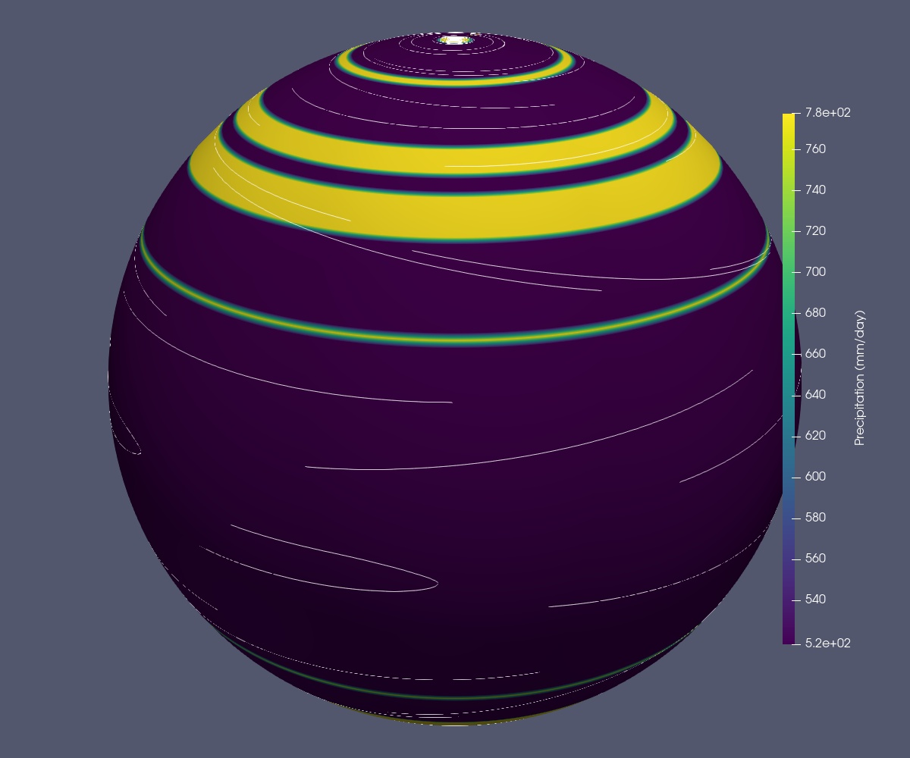

# ATHAD_PERID

**The atmosphere a peridotitic magma ocean left behind.**

<p align="center"></p>

<p align="center"><sub>Precipitation (mm/day) at the surface of the CO₂ atmosphere over the 20–150 °C ocean, 518–778 mm/day in bands; white: surface-wind stream lines; north pole at the top. Arm <code>run_long_tied</code> (Tiedtke convection) at iteration 400, drawn from the level-0 radial slice with <code>literature/hadean_globe.py</code> (outside the repo).</sub></p>

**The Hadean family.** Three successive epochs of the early Earth, one model each, forked from one another with their full history so fixes cherry-pick in both directions:

| Model | Epoch | Atmosphere | Surface |
|---|---|---|---|
| [ATHAD](https://github.com/RogerGrundmann/ATHAD) | ~4.4 Ga, over the magma ocean | steam (H₂O-dominated), ~250 bar | molten or quenching rock, no topography |
| [ATHAD_COND](https://github.com/RogerGrundmann/ATHAD_COND) | after the steam rained out | CO₂-dominated, 27–100 bar | liquid sea at 230–250 °C |
| **ATHAD_PERID** (this repo) | after a peridotitic magma ocean solidified | CO₂-dominated, 5–20 bar | ocean at 20–150 °C |

**Sister family:** the same ATOM numerics run the giant planets -- [ATJUP](https://github.com/RogerGrundmann/ATJUP), [ATSAT](https://github.com/RogerGrundmann/ATSAT), [ATURAN](https://github.com/RogerGrundmann/ATURAN), [ATNEPT](https://github.com/RogerGrundmann/ATNEPT).

An atmospheric general-circulation model of the Hadean epoch that follows
[ATHAD_COND](https://github.com/RogerGrundmann/ATHAD_COND): the magma ocean has solidified,
the steam has long since rained out, and the volatiles a **peridotitic** (ultramafic,
mantle-composition) melt outgassed have cooled into a **CO₂-dominated atmosphere of 5–20 bar
over a 20–150 °C ocean**. Same solver throughout the family — finite-difference Navier–Stokes
on a spherical shell, RK4 in time, stretched vertical coordinate.

**"Peridotitic" names where the volatiles came from, not the present surface.** The melt is
gone; what this model carries is its outgassed inventory, cooled. So the thermodynamic regime
is ATHAD_COND's — subcritical water, a liquid sea, condensation live from the surface up — and
NOT ATHAD's supercritical column. That is why the fork is cut from ATHAD_COND and keeps its
invariants rather than inverting them.

ATHAD_PERID is forked from ATHAD_COND at `3f0b05d`, **carrying its full history** — 63 commits
reaching back to ATHAD's own fork-from-ATOM commit — so fixes cherry-pick in every direction
(`git remote cond` and `git remote athad` point at the two sibling working copies). ATHAD_COND
came from ATHAD @ `29ca2f9`, and ATHAD from
[ATOM_Precipitation](https://github.com/RogerGrundmann/ATOM_Precipitation) @ `1e3f319`.

**Where it differs from ATHAD_COND:** the same physics at a quarter of the pressure and 155 K
colder, with a genuinely CO₂-dominated composition — 78 mole-% CO₂ against COND's 35 %, and
water down from 56 mole-% to 4.6 %. The sea still sets the surface humidity, but it is a
much drier atmosphere sitting on it.

## The convection scheme is a moist convective adjustment since 2026-10-10 — the Tiedtke scheme is no longer called

`ATM_CONV_SCHEME=<adjust|tiedtke>`, default `adjust`, at the user's instruction ("replace the Tiedtke scheme with a simple moist convective adjustment", then "the same switch in ATHAD and ATHAD_PERID").

The full text is in [CLAUDE.md](CLAUDE.md).


## ATHAD_COND's convection instruments and knobs are in this tree since 2026-10-10

`atmosphere/MoistConvection.h` is ATHAD_COND's file again, byte for byte (the two were identical until that day), and `atmosphere/SaturationAdjustment.h` carries ATHAD_COND's budget (`a75b6ab`).

The full text is in [CLAUDE.md](CLAUDE.md).


## The first baseline, and what it says the model cannot do yet

40 iterations, 24 threads, shipped defaults, moist physics from iteration 0.

The full text is in [CLAUDE.md](CLAUDE.md).


## The background opacity, split per species — a no-op that stopped being one

Ported from ATHAD (its README item 60), where `kappa_bg` = 1e-6 m2/kg — the value of a radiatively inert diatomic — was being applied to a background containing NH3 and CH4 at 1.4 mole-% each, and splitting it raised the effective background opacity 1867x.

The full text is in [CLAUDE.md](CLAUDE.md).


## The sweep count: p_dyn's amplitude and Psi are DECOUPLED, and the 28 % was the initial projection

The first version of this section attributed a 28 % drop in `Psi_max` to the time-loop solve.

The full text is in [CLAUDE.md](CLAUDE.md).


## The CO2 distribution work ported from ATHAD (its README items 56-57, 59)

This fork had already found half of it, and the half it found was the right half. `ThermoAtm::co2Atmosphere()` did not fill a uniform mass fraction.

The full text is in [CLAUDE.md](CLAUDE.md).


## Repository layout

```
atmosphere/   C++ source — the atmosphere model
cli/          Command-line interface source and config file
lib/          Array classes, config reader, shared utilities
python/       Cython bindings, run scripts, output directory
test/         Standalone self-tests
tinyxml2/     Vendored XML parser
```

## Build, run, test

```bash
make perid                                      # -> cli/perid
make test                                       # self-tests, run these first
cd python && OMP_NUM_THREADS=8 ../cli/perid config_perid.xml
```

Output lands in `python/output_Hadean_peridotite/`.

`make` regenerates the parameter bindings from `param.py` first. The generated files are
tracked on purpose, so a `param.py` change shows its full effect in the diff.

## Conditions

The stated inputs are **p = 5–20 bar, T = 20–150 °C, CO₂ 60–80 %, N₂ 10–20 %, SO₂ ~1 % by
mole**. The nominal run point is the midpoint, **12.5 bar / 358.15 K (85 °C)** — the same
convention ATHAD_COND used in taking 60 bar / 240 °C out of 27–100 bar / 230–250 °C.

**`x_H₂O` is not an input.** It is set by the sea: `p_sat(358.15 K) = 0.5787 bar` of a 12.5 bar
column, so **`x_H₂O` = 0.0463** at the surface. CO₂, N₂ and SO₂ fill the remaining 95.4 % in the
stated dry ratio 70 : 15 : 1. Verified against the model's own `AtmMixture::resolve()`:

| | mole fraction | mass fraction |
|---|---|---|
| H₂O | 0.0463 | 0.021235 |
| CO₂ | 0.7417 | 0.831045 |
| background (N₂ 0.1590 + five traces at 0.0106 each) | 0.2120 | 0.147719 |

- **M_mean = 39.278 g/mol**, **R_mix = 211.68 J/(kg·K)**
- **Background** (everything but H₂O and CO₂): M_bg = 27.369 g/mol, **R_bg = 303.79 J/(kg·K)**.
  This is what `R_Air` means. `M_nonwater` = 40.311 g/mol is the different number that matters
  for saturation.
- **p_surf = 12.5 bar**, **T_surf = 358.15 K** (prescribed), **ρ_surf = 16.49 kg/m³**
- cp = 947.9 J/(kg·K), cv = 736.2 — a third of ATHAD's and two thirds of ATHAD_COND's, because
  the mixture is now mostly CO₂
- **scale height 7.73 km**, dry lapse **10.35 K/km** (ATHAD_COND: 15.7 km and 7.14 K/km)

**The surface is saturated by construction**, which is this fork's inherited defining condition:
`q_sat` at the sea = 0.021233 against `q_H₂O` = 0.021235. Water boils at **462.96 K** at 12.5 bar,
so the sea is **105 K below boiling** — a wider margin than ATHAD_COND's 35 K.

**All five trace gases are present at ~1 mole-% each**, as stated, in the dry ratio
70 : 15 : 1 : 1 : 1 : 1 : 1 (CO₂ : N₂ : SO₂ : CH₄ : NH₃ : CO : H₂), with CO₂ absorbing the
rounding so the eight sum to 1.0000000000. They are **not** the inherited values: the fork
initially carried ATHAD_COND's CH₄/NH₃/H₂/CO at 1.4 % each simply because they came with the
clone, which left the mole fractions summing to 1.056 and `M_bg` 13 % adrift until the startup
guard refused to run. By mass the background is N₂ 0.768, SO₂ 0.117, CO 0.051, NH₃ 0.031,
CH₄ 0.029, H₂ 0.004, so **Σf_i·κ_i = 6.39e-04 — 639× the lumped `kappa_bg`**, carried mostly by
NH₃ and SO₂. That is item 60's per-species split earning its keep on a third composition.

**The cold-trap floor is derived from this column**: `c_h2o_dry_top` = 4.06e-04, the `q_sat`
minimum at level 24 (14.59 km, 254.0 K, 1.233 bar) where the profile goes isothermal. The
inherited ATHAD_COND value was 0.00452 — **11.1× wetter than this column can hold**, which is
that fork's own "cold trap is eight times too wet" defect arriving here by inheritance.

**`albedo_surface` = 0.06** is a water value and correct for an ocean surface — but do not carry
over ATHAD_COND's finding that it is not a lever. There a 25 % change in it was invisible because
the cloud deck saturated the compositing `refl = tau/(tau+2)` at 0.9999909 in every column. **This
atmosphere holds 17× less water** (q_H₂O 0.0212 against 0.3616), so the deck may not be total and
the clear-sky value may show through. Measure it here before assuming either way.

## Four invariants — do not silently break these

1. **There is no topography, and the planet is hemispherically symmetric.** `h ≡ 0`,
   `i_topography ≡ 0` everywhere, so `AtomUtils::is_land()` is false at every point — now a
   global *ocean* rather than a global magma surface, but the same statement in code.
   `LandOceanFraction()` throws if a land point ever appears. Any north–south asymmetry in
   the output is a defect: the surface temperature is a symmetric parabola, the insolation
   is mirrored, and there is no obliquity and no seasonal cycle.

2. **Water is subcritical everywhere, and condensation is live.** *This is ATHAD's
   invariant 2, inverted.* Critical point 647.096 K / 220.64 bar; this column runs
   511 K / 60 bar downward, so every condensation path is a path that runs. What carries
   over unchanged is *which formulas are allowed*: **never reintroduce Magnus** (calibrated
   to ~320 K, returns 1.2e7 hPa at 513 K) and **never the dilute `q_sat = ep·E/(p−E)`**.
   The dilute form is invalid here for the opposite reason it was invalid in ATHAD — water
   is 0.4 % by mole above the cold trap, where it would be fine, and 56 % at the sea, where
   it is not. A form valid over part of the column is worse than one valid over none,
   because it looks right in the printouts.

3. **Radiation runs in mode 2** (direct σT⁴). Modes 0/1/3/4/5 lean on the Scotese snapshot
   or the 280 ppm CO₂ reference; neither exists in a 92 % CO₂ atmosphere at 4.4 Ga.

4. **The column is on its own adiabat, integrated not fitted — and the adiabat is MOIST
   where the air is saturated.** `SaturationH2O::moistLapse`, hydrostatic on the layer-mean
   T, isothermal above `t_skin`. Do **not** restore the COSMO `T = T₀√(1−coeff·h)` form, and
   do **not** revert to the dry adiabat: `cosmo_lapse_fraction = 1.0` is justified in ATHAD
   *because nothing condenses there*, and that justification is void here.

## What the model currently says

Everything below is measured. Items refer to the commits.

**1. The moist adiabat, and the number that nearly went in wrong.** The saturated lapse
rate is

    dT/dz = −g·[1 + L·A/(R_mix·T)] / [cp + L²·A/(R_v·T²)],   A = x·Mw·Mo/den²

and the familiar `g/(cp + L·dq_sat/dT)` is only its denominator. That truncation gives
**0.7 K/km** at this sea surface; the full expression gives **5.04 K/km** against a dry
7.27. A factor of seven, and the truncated form is the one that looks like the textbook.
The neglected term is the pressure dependence of `q_sat`, negligible for a trace gas and
not for 56 % water. Checked against Earth at 300 K / 1 bar, where it returns 3.81 K/km.

**2. `dq_sat/dT` was the dilute limit.** `q_sat·L/(R_v·T²)` is the `x → 0` form; the exact
mass-fraction derivative is larger by `M_other/(x·Mw + (1−x)·Mo)` = **1.478** at the sea
surface. This fed the saturation adjustment's Newton damping `ω = 1/(1+Gain)`, so the
damping was a third too weak in exactly the high-`q_sat` regime it exists for.

**3. The initial state is a fixed point of three fields, and iterating it does not
converge.** `c` depends on T and p, `co2` depends on `c`, and T and p depend on both.
Iterating them closes a loop over the runaway-greenhouse feedback: 3 passes gave 446.7 K at
8.9 km, 8 passes gave 463.8 K, still climbing. That is the correct physics arriving through
the wrong numerics. `densities(true)` integrates the water profile in the same upward sweep
as T and p — one pass, exact.

**4. The measured column.** A saturated troposphere **62 km deep**: 511 K at the sea, 487 K
at 4.5 km, 429 K at 18 km, 367 K at 34 km, 280 K at 60 km, with the first 10 km at
**5.02 K/km** against the 5.04 predicted. `q_H₂O` tracks `q_sat` to four digits throughout.
Precipitable water **133.5 m**.

**5. The cold trap is eight times too wet.** It sits at the inherited `t_skin` and 0.02 bar
and passes **0.0349 kg/kg** of water, against the **0.00423** the stated dry composition
implies. The stated "H₂O 0.4–2 % by mole" and the stated 230–250 °C sea are mutually
consistent only if the cold trap is near **217 K**, which is what `p_sat/p = 0.0099` at
0.02 bar requires. So `c_h2o_dry_top` is currently a floor the column never reaches.

**6. The OLR is not yet an output.** At 20 iterations:

```
mean planetary albedo    = 0.4997        absorbed SW + geothermal = 120.84 + 150.00 = 270.84 W/m2
outgoing long wave (OLR) = 268.10 W/m2   imbalance                = 2.74 W/m2
lid temperature / eps    = 262.22 K / 0.0000
sigma*T_lid^4            = 268.10 W/m2
```

**OLR and σT_lid⁴ are equal to six figures.** This is exactly the condition ATHAD's item 10
diagnosed and the diagnostic was built to flag. The cause here is different from ATHAD's,
though: the lid is genuinely transparent (eps = 0.0000) and the shell is deep enough. The
grey optical depth reaches 1 at ~0.07 bar, which is *where the isothermal skin begins*, so
the emission to space comes from a layer whose temperature is prescribed — and `t_skin` is
a fixed point relaxing to close the very balance being reported. The balance closes to
2.74 W/m² because it was constructed to.

Deepening the shell will not fix this. It is the isothermal-skin prescription that has to
go, which is the same open task as ATHAD's invariant 3.

## Assumptions vs. results — read this before quoting any number

| Parameter | Value | Status |
|---|---|---|
| `geothermal_flux` | 150 W/m² | **Inherited from ATHAD's magma ocean and almost certainly wrong here.** It is 55 % of the entire energy input, against modern Earth's 0.087 W/m². A quenched surface under a liquid ocean does not deliver this. **Biggest unexamined input.** |
| `kappa_H2O` / `kappa_CO2` / `kappa_bg` | 0.01 / 0.001 / 1e-6 m²/kg | Factor-of-2 uncertain. `kappa_CO2` now dominates: the CO₂ column is 5.8e5 kg/m² against water's 2.6e3 |
| `t_surf_equator` / `t_surf_pole` | 513.15 / 503.15 K | **Prescribed, not solved.** The 10 K contrast is an assumption |
| `t_skin` | fixed-point iterate | Currently *sets* the OLR — see item 6 |
| `albedo_cloud` | 0.50 | IS the model's planetary albedo (0.4997 measured); saturates the moment condensate exists, and condensate is now everywhere |
| insolation | 0.71 S₀ | Faint young Sun |
| `omega` | 3.17e-4 (5.5 h day) | Inherited from ATHAD; a post-condensation Earth is later and slower |
| `delta_i_c` | 500 s over ocean | Bechtold's convective adjustment timescale, Earth-calibrated. A time, not a pressure — no unit error to correct, and no evidence here to replace it |
| Shomate `cp` below 298 K | clamped | The cold trap and skin sit below the fit range |

A grey scheme cannot represent the window regions that set the real runaway limit.

## The pattern this fork was expected to bring, and did

ATHAD's README records seventeen defects of one shape:

The full text is in [CLAUDE.md](CLAUDE.md).


## Reproducibility

Run-to-run bit-identical at a fixed thread count; thread-count dependent at ~1e-8. Measured at 24 threads, three one-iteration runs identical in every number, and at 20 iterations 24 threads against 8 agree in every wind extremum and differ in the last digit of `residuum_atm` (0.77593489 against 0.77593490).

The full text is in [CLAUDE.md](CLAUDE.md).


## What the surface state still breaks — audit, 2026-08-18 (items 1-3 RETRACTED same day)

The surface moved from ATHAD's 250 bar / 1500 K / supercritical to 60 bar / 513.15 K / subcritical.

The full text is in [CLAUDE.md](CLAUDE.md).


## Remaining work

`ATM_CELL_ALTERNATE` IS THE DEFAULT HERE SINCE 2026-08-24, AND IT TURNS A SINGLE-SIGNED DRIFT INTO A FIVE-CELL HEMISPHERE (ATHAD README item 69).

The full text is in [CLAUDE.md](CLAUDE.md).

